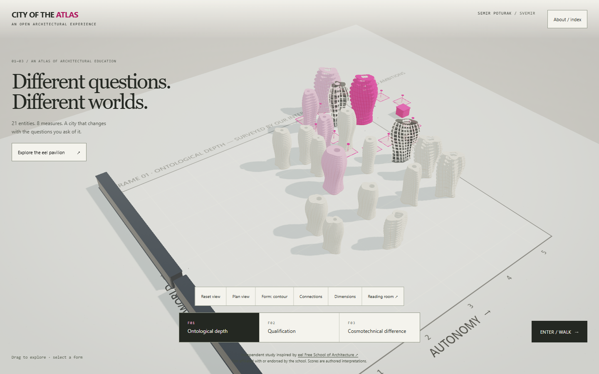

# City of the Atlas

**An open experiment: what if the reading of an architectural school were an instrument you could walk through, argue with, and change?**

Twenty-one entities, eight authored measures, three ways of reading architectural education. Change the question and watch the city rearrange. Inspect a form, compare its measures, or enter the model at eye height. Every score is published, every formula is documented, and every disagreement with them is welcome — the instrument exists so that the reading can be contested.



## The experiment

- **Who.** [Semir Poturak](https://github.com/3esign) — architect, university educator and PhD researcher working on architectural education, computation and fabrication. The city was drawn, tested and verified inside **Svemir**, his open working universe in which several AI minds plan, build and check one another's work in parallel; this repository is one public record of what that collaboration can produce.
- **Independence.** Inspired by [eel Free School of Architecture](https://eelfreeschoolofarchitecture.com/), whose published ideas set the questions. Independently created; **not affiliated with, commissioned by, or endorsed by the school**. Scores and relationships are provisional interpretations, not institutional ratings.
- **Collaboration.** MIT-licensed, local-only, no analytics. Correct a score, propose an entity, add a frame, or fork the whole city for another field of knowledge — [open a conversation](https://github.com/3esign/city-of-the-atlas/issues).

The same statement lives inside the instrument: the **colophon** opens from the signature in the masthead, the footer, the About drawer, or `?about`.

## Experience

- A responsive exhibition HUD with frame navigation, an entity index and a reading room.
- **A guided tour (T):** the instrument tells its own argument — frames, plan, dusk, the origin — in eight captioned arrivals. Any drag takes the camera back mid-sentence.
- **Choreographed camera:** selections, the plan, the tour and the opening sweep all arrive rather than teleport; one `flyTo` system with the shortest arc, cancelled the moment a hand touches the canvas.
- The reader's marks: a dashed ink circle at the foot of the entity being read, a fainter one under the pointer — drafting language, not glow.
- Weather as a depth cue: eight slow ink-wash clouds that take the dusk with everything else and step aside for the plan.
- Procedural contour architecture: measures shape lobes, atriums, floors, ribs, twist and height.
- A plan that actually fits: the camera solves the free area the HUD leaves, turns the sheet when the survey runs diagonally, and names every entity by rank.
- A city that is inhabited by its own numbers: two walking figures per point of access, one street lamp per point of evidence, traffic on every proposed connection, and a dusk switch that makes the lighting legible.
- Contour / Terraces comparison, optional relationship lines and dimensions.
- Exterior walking with keyboard or touch joystick, orientation map and an explicit exit.
- Reduced-motion support, render-on-demand, a static reading room and an offline single-file build.
- Local Three.js; no runtime CDN, external fonts, analytics or package installation.

The forms are speculative models, not the buildings of the named institutions. Walking uses exterior collision envelopes; interior circulation is not implemented.

## Run locally

Node.js 22 or later:

```sh
node build.js
node tests/check.cjs
node serve.js 8788
```

Open `http://localhost:8788/`. The generated `city.html` also opens directly from disk. Keep `atlas-table.html` beside it for the reading room.

## GitHub Pages

The project is ready for a repository subpath; all runtime assets use relative URLs. The included **Publish architectural atlas** workflow builds, checks and uploads only the static release files.

Publication is deliberately manual: set the repository's Pages source to **GitHub Actions**, then run the workflow. This repository does not claim an active Pages deployment until one has completed. A future maintainer may add a push trigger for continuous publishing.

## Controls

| Action | Desktop | Touch |
| --- | --- | --- |
| Guided tour | Tour; T | Tour, in About / index |
| Orbit | Drag; arrow keys | One-finger drag |
| Zoom | Wheel; + / − | Pinch |
| Change frame | Bottom tabs; 1 / 2 / 3 | Bottom tabs |
| Select | Click a form; About / index | Tap a form; About / index |
| Walk | Enter / walk; F | Enter / walk |
| Move in walk mode | W A S D; Shift to run | Left joystick |
| Look | Pointer lock or drag | Drag outside joystick |
| Exit walk | Esc; Model button | Model button |
| Plan, everything named | Plan view; P | Plan view |
| Day / dusk | Dusk; N | Day / dusk, in About / index |
| Population on / off | Life; L | About / index |
| Reset | Reset view; R | Reset view |

Additional controls are available in About / index on narrow screens. Links: `#f0`, `#f1`, `#f2` select frames; `?e=0` opens an entity; `?walk` enters walking.

## Sources and verification

[Design foundations](DESIGN.md) · [Method and formulas](METHOD.md) · [Design reference study](RESEARCH.md) · [Validation and limits](QA.md) · [Credits and rights](NOTICE.md)

The numerical dataset is authored and uncalibrated. Public notes frame exploratory questions; the Taliesin continuation correction includes its primary source. Other notes do not establish current programmes, accreditation, costs or partnerships. Source artwork is not redistributed.

Original code and documentation: MIT. Three.js retains its own MIT notice. Third-party institutional names and publications are outside the license grant.
